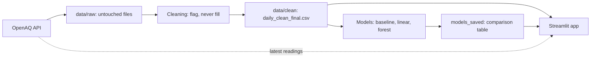

# Mumbai Heat & Air Quality Risk Intelligence

A Streamlit dashboard for 23 monitoring stations in Mumbai. It shows the latest PM2.5, PM10 and temperature with a source and a freshness label on every card and chart. It also has historical charts, a station map, a data-quality page, and an honest test of whether simple models can forecast next-day PM2.5 better than "tomorrow = today".

**Live app:** TODO (paste the link after deployment)
**Screenshot:** TODO (add a screenshot or GIF of the Home and Map pages)

## The main result, in plain words

No model clearly beat the simplest forecast, "tomorrow's PM2.5 = today's PM2.5". So the app shows the comparison table and **no forecast line**. This is a real result, not a failure to report. The reasons, and what we do not know, are on the Forecast page and below.

## What the app contains

| Page | What it shows |
|---|---|
| **Home** | Pick a station. Cards show the latest PM2.5, PM10 and temperature, the reading time in IST, a freshness label and the source. |
| **Charts** | Daily, weekly, monthly and by-season charts for any station and variable. Missing days appear as breaks. |
| **Map** | One dot per station. Color is the PM level (CPCB bands), blue is a valid temperature, gray is no recent valid reading. Click a dot for details. |
| **Forecast** | The model comparison table, the verdict, and the limitations. |
| **About Methodology** | Data sources, cleaning rules, forecast method and limitations. |
| **Inputs Explained** | What the models learned from their three inputs. Labeled "not a recommended forecast". |
| **Data Quality** | Clean-day share per station, a summary table, and every flagged day. |
| **Live Chart** | The last 48 hours of 15-minute readings for a station and variable. |

**Freshness labels** (our own cut-offs, not official): **Live** is under 2 hours old, **Delayed** is 2 to 48 hours, and **Historical** is older than 48 hours.
**Times:** stored in UTC, shown in IST (Asia/Kolkata). Daily values are IST calendar days.

## Data sources and credit

- **OpenAQ API v3** gives the latest readings and daily summaries. OpenAQ collects the data from the original providers and operators (CPCB, MPCB, BMC and IITM for these stations). We credit both OpenAQ and the operators.
- OpenAQ says it only ingests openly licensed data and asks users to follow each original provider's terms. **We have not yet read each provider's own terms**, and the licence field in the API was empty for the station we checked. Check this before reusing or redistributing the data.
- **Not used:** NASA POWER, CPCB's own site, IMD and Open-Meteo.
- **Stations:** 23 Mumbai stations that reported within the last 7 days and have both a PM2.5 and a PM10 sensor. Navi Mumbai, Thane, Mira-Bhayandar and stations that stopped reporting are left out.
- **Sensors:** only the newer sensor of each station (from February 2025). Older sensors from 2019 to 2022 are not used. They stop in 2022, so there is a gap of about two years.
- **Period:** daily data from 19 February 2025 until the date you run the download. About 21 months at the time of writing.
- **Two stations are only 78 m apart** (Bandra Kurla Complex IITM and Kherwadi), so they are not independent evidence.

## How it works



`python run_all.py` runs these steps in order:

1. `src/ingest/openaq_locations.py` downloads the station list near Mumbai.
2. `src/ingest/build_stations_config.py` picks the stations and sensors and writes `data/clean/stations_config.json`.
3. `src/ingest/download_daily.py` downloads the daily summaries and saves them untouched in `data/raw/`, each with a `_metadata.md` note (source, URL, download time, sensor).
4. `src/cleaning/build_clean.py` flags suspect days and writes `data/clean/daily_clean_final.csv`.
5. `models/pooled_model.py` trains the models and writes `models_saved/model_comparison.csv`.

## Data cleaning rules

**Nothing is deleted and nothing is filled in.** A flagged day gets a blank `clean_value`, and the raw value stays in the file. Missing days are never interpolated, because filling a gap would use values from after it.

| Rule | Limit |
|---|---|
| Low coverage | A day needs at least 75% of its readings |
| PM impossible | PM at or below 0, or above 1,000 µg/m³ |
| PM far from neighbors | More than 5 times the same-day median of all stations, and above 200 |
| Temperature impossible | Daily average below 10 °C or above 45 °C |
| Temperature far from neighbors | More than 8 °C from the same-day median of the stations |

**All of these limits are my own choices, not official rules.** They catch obvious faults, but not every bad value. Flagged days are listed on the Data Quality page.

## Forecast method

- **Target:** daily average PM2.5 (IST day). **Horizon:** the next day.
- **Baseline:** tomorrow equals today.
- **Models:** Linear Regression and Random Forest (100 trees, random seed 42), one model trained on all stations together.
- **Inputs:** today's value, yesterday's value, and the average of the last 7 days (at least 4 real days). No future data is used.
- **Split by time, never random:** trained on days up to 29 June 2026, tested from 1 July 2026.
- **Avoiding data leakage:** a forecast only uses data up to its own day, gaps are not filled, and the baseline and both models are scored on exactly the same test days.
- **Scores:** MAE is the average miss in µg/m³. RMSE is similar, but big misses count more. Lower is better.

## Results

Pooled over 23 stations. Training rows were 6,262 and test rows 1,617 (1 July to 12 November 2026). Numbers are from the run on 13 November 2026, and a rerun with newer data will change them.

| Forecast | MAE (µg/m³) | RMSE (µg/m³) |
|---|---|---|
| Baseline (tomorrow = today) | **4.7** | 9.7 |
| Linear Regression | 4.9 | **9.6** |
| Random Forest | 5.3 | 9.7 |

By station, Linear Regression beat the baseline on both MAE and RMSE at 5 of 23 stations, by small margins (0.1 to 0.7 µg/m³). Random Forest did so at 1. At the other stations, neither model did. I did not test whether those few wins are more than chance. The full table is in `models_saved/model_comparison.csv` and on the Forecast page.

## Limitations and known issues

- About 21 months of data, so only one winter, and the test period (July to November) is mostly monsoon with almost no winter.
- The 1 July split date is my own choice, and I did not try other dates.
- No station had a clean PM2.5 value on 3 and 4 November 2026. The cause is unknown.
- Many temperature sensors report stuck or impossible values. At the time of writing, four stations have no clean temperature days at all (Borivali East IITM, Malad West IITM, Deonar IITM and Bandra Kurla Complex IITM). That is why PM2.5 is the forecast target.
- Mulund West has very few clean PM10 days, mostly because of low coverage.
- Map colors use CPCB 24-hour category bands on a single latest reading. They are indicative and not an official AQI. The bands were taken from a research paper that reproduces the 2014 CPCB table, not from CPCB's own page.
- Each station is one sensor at one spot. It does not describe a whole neighborhood.
- Patterns the models find show links, not causes. Correlation is not causation.
- No prediction range is shown, because we cannot estimate one reliably with this little data.

## Project structure

```
app/                     Streamlit app: Home.py and pages/
src/ingest/              station list, station config, daily download
src/cleaning/            build_clean.py (flag, never fill)
models/                  baseline.py, compare_models.py, pooled_model.py
models_saved/            model_comparison.csv
data/raw/                downloaded files, never edited (not on GitHub)
data/clean/              cleaned data and stations_config.json
tests/                   5 automated tests
notebooks/               exploration
run_all.py               one command to rebuild everything
requirements.txt         short package list used for deployment
requirements-full.txt    full list of my local environment
```

## Setup (Windows PowerShell)

1. Clone the repository and open the folder.
2. Create and activate an environment (I developed with Python 3.14):
   ```
   python -m venv venv
   venv\Scripts\activate
   pip install -r requirements.txt
   ```
3. Get a free OpenAQ API key at https://explore.openaq.org/register. Copy `.env.example` to `.env`, open it, and put your key in. **Never share or commit the key.**
   ```
   copy .env.example .env
   ```
4. Rebuild the data and models (about 70 requests, around 2 minutes, within the free limit of 60 per minute):
   ```
   python run_all.py
   ```
5. Start the app:
   ```
   streamlit run app/Home.py
   ```

The cleaned data and results are committed to this repository, so the Charts, Forecast, About, Data Quality, Map position and Inputs pages work without step 4. Home, Map colors and Live Chart need your key, because they call OpenAQ live.

## Tests

```
pip install pytest
python -m pytest tests -v
```

Five tests check the cleaned data (no duplicate days, possible PM values, temperature range, flagged days are blank) and the model results table. They do not test the app pages.

## Deployment

Deployed on Streamlit Community Cloud from the `main` branch with `app/Home.py` as the main file. The key is stored in the app's Secrets setting as `OPENAQ_API_KEY`, not in the code. The pages read it from Streamlit secrets first and from `.env` otherwise.

## Not built yet

A question-and-answer assistant that answers only from our data, a transparent risk indicator, a heat index, an API with a database, and a check of the models on winter data. More history from the 2019 to 2022 sensors could help the forecast, but it was not tried.

## Glossary

- **PM2.5 / PM10:** tiny particles in the air, smaller than 2.5 and 10 micrometres.
- **UTC / IST:** UTC is the standard clock used for storage. IST is Indian time, UTC plus 5:30.
- **Baseline:** the simplest possible forecast, which every model must beat.
- **MAE / RMSE:** two ways to score forecast errors. Lower is better.
- **Data leakage:** a model seeing information during training that it would not have in real life.

---
## 👤 Author
**Prajwal Wankhede** · [LinkedIn](https://www.linkedin.com/in/prajwal-wankhede-22388628a) · [GitHub](https://github.com/prajwal-sv)

**Live app:** [mumbai-air-quality-and-temperature.streamlit.app](https://mumbai-air-quality-and-temperature.streamlit.app/)